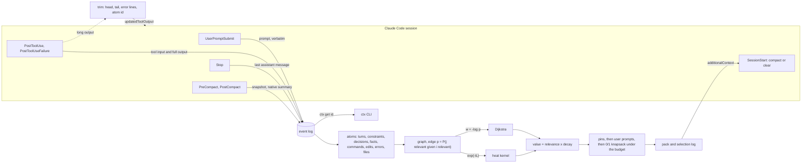
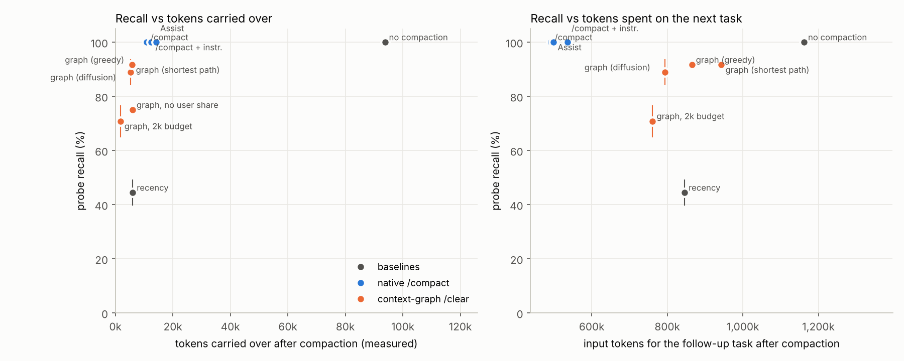
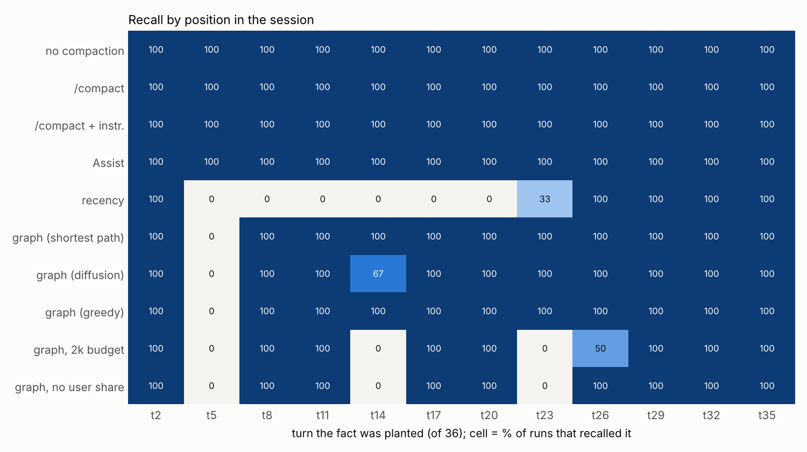

# context-graph

A Claude Code plugin that records a session as a graph while you work and, after `/compact` or `/clear`, rebuilds the context by calculation (shortest paths or heat diffusion, decay, a knapsack token budget) instead of relying on one model-written summary.

The two goals, in order: lose nothing that matters, then spend fewer tokens. A method that saves tokens by forgetting things loses.

Why this matters: in the author's own long Claude Code sessions, each `/compact` read 437k to 830k tokens, took 134 to 182 seconds, and produced a summary of 20k to 28k characters, written by a model deciding on its own what the rest of the session will need. Context engineering is "the delicate art and science of filling the context window with just the right information for the next step" (Karpathy 2025), and models do worse as their input grows longer (Hong, Troynikov and Huber 2025) and with relevant facts in the middle of it (Liu et al. 2024). This project treats that as a selection problem with an explicit budget and a log of every choice.

## A real run

This is `ctx` on the graph recorded in benchmark run A1: a 36-turn scripted coding session on a small Python ledger (`bench/demo_repo`), driven through `claude -p`.

```
$ ctx stats
thread e051ccef-83fb-4fd7-b5ca-721c91231d8c  sessions 1  turns 36  events 187
atoms 240: command 45, constraint 7, decision 9, edit 61, error 11, fact 7, file 19, lookup 9, reply 36, turn 36
edges 1011; full text held 156895 chars

$ ctx show
240 atoms, 1011 edges, turn 36. selector=graph relevance=dijkstra solver=knapsack mode=replace
budget 6000 tokens: pinned 1016, chosen 4114, pack ~5965. focus: u36 (1), u35 (0.5)

    id                    kind       turn   tok     rel  decay   value  text
PIN u36                   turn         36    64   1.000   1.00  1.0000  user: "Next I want to work on balance performance and refunds. Befo...
PIN k35.1                 constraint   35    38   0.450   0.92  0.4127  Don't add third-party dependencies to this project; standard librar...
PIN n32.1                 fact         32    34   0.165   0.71  0.1164  Our fiscal year starts on April 1, so Q1 runs from April to June.
PIN k29.1                 constraint   29    45   0.165   0.55  0.0898  All CLI output must stay CSV with a header row. The finance team pa...
PIN n23.1                 fact         23    24   0.091   0.32  0.0294  This work is tracked in the ticket FIN-2291.
...
+   r36                   reply        36   282   0.800   1.00  0.8000  assistant: The CLI has these commands. `--db` is a global option th...
U   u35                   turn         35    59   0.500   0.92  0.4585  user: "Don't add third-party dependencies to this project; standard...
+   r7                    reply         7   219   0.352   1.00  0.3517  assistant: I added an `accounts` command to `ledger/cli.py`. It pri...
+   t184                  command      35    85   0.300   0.92  0.2751  $ grep -rhoE "^(import|from) [a-zA-Z_][a-zA-Z0-9_]*" --include=*.py...
```

`PIN` rows are always kept word for word, `U` rows are the user's own prompts kept within their share of the budget, `+` rows were chosen by the knapsack. Asking why a root cause stated at turn 17 survives:

```
$ ctx explain d17.1
d17.1  decision  turn 17  71 tokens  source=user  PINNED
render: The root cause is that monthly_report compares entry dates with < against the last day of the month, so entries dated on the last day are dropped.
symbols: monthly_report

relevance 0.0583 (dijkstra)  x  decay 0.193 (last used turn 17, now 36, half-life 8 turns)  =  value 0.01124

most probable chain from the focus (Dijkstra, w = -log p):
  u35            focus weight 0.5  -> p = 0.500
  t184           p(edge) = 0.600 [in turn]  -> p = 0.3000  surprisal 1.20
  f:/tmp/cg-bench/A1/test_out.txt p(edge) = 0.600 [file /tmp/cg-bench/A1/test_out.txt]  -> p = 0.1800  surprisal 1.71
  t90            p(edge) = 0.600 [file /tmp/cg-bench/A1/test_out.txt]  -> p = 0.1080  surprisal 2.23
  u17            p(edge) = 0.600 [in turn]  -> p = 0.0648  surprisal 2.74
  d17.1          p(edge) = 0.900 [stated in]  -> p = 0.0583  surprisal 2.84

decision: KEPT (pinned: always carried over, verbatim)
```

Its value is low (0.011): by relevance and decay alone it would have been dropped. It is kept because it is pinned. The start of the pack that `/clear` puts back:

```
# Carried-over context (context-graph)
The conversation was cleared. This is what was kept from it: 103 of 240 items from the session graph, chosen by
relevance to the latest request and by recency, about 5749 tokens. Items under PINNED are the user's constraints
and stated facts and the decisions already made, copied word for word: follow them. Each item starts with its [id]:
`ctx get <id>` with Bash prints that item's full text, such as the whole output of a command.

## PINNED: constraints, decisions and stated facts (verbatim)
- [k2.1] (turn 2, user) Rule for this codebase: never use float for money. Amounts are integer cents end to end.
- [d4.a1] (turn 4, assistant) Both are now rejected.
- [n5.1] (turn 5, user) For context, the production ledger database lives on the host ledger-db-07.internal, port 6432.
- [d8.1] (turn 8, user) Decision: we'll store ledgers in SQLite through the sqlite3 module.
- [d8.2] (turn 8, user) The JSON-file storage idea is rejected because it corrupted data on concurrent writes.
- [k11.1] (turn 11, user) Don't touch anything under legacy/. The payments team owns it and their CI breaks when we change it.
```

The second pin (`d4.a1`, "Both are now rejected.") is noise: rule-based detection pinned a sentence that means nothing out of context. That kind of error is listed under known limitations.

## Architecture



| Hook | What it does |
|---|---|
| `UserPromptSubmit` | stores the prompt word for word; the latest prompts are the focus |
| `PostToolUse` | stores tool name, input and full output; returns a trimmed copy of long Bash output as `updatedToolOutput` |
| `PostToolUseFailure` | stores the failed call and its error text (a failing Bash command arrives here, not in `PostToolUse`) |
| `Stop` | stores `last_assistant_message`, where decisions get stated |
| `PreCompact` | snapshots the event log |
| `PostCompact` | stores the native `compact_summary`, the baseline |
| `SessionStart` (`compact`) | Assist mode: adds pins to the native summary |
| `SessionStart` (`clear`) | Replace mode: the pack is the whole carried-over context, no model call |
| `SessionEnd` | records that a session ended with `clear`, so the next session joins the same graph |

Code: `context_graph/` (standard library only), `hooks/hooks.json`, `.claude-plugin/plugin.json`, `bin/ctx`. Every selection writes a JSON log of what was kept, what was dropped and every score (`ctx log`).

## Decisions and trade-offs

* **A selection instead of a summary.** A summary is written by a model guessing what will matter, and it paraphrases. A selection keeps the original text of what it keeps and drops the rest whole, so every kept item can be traced (`ctx explain`) and every dropped one paged back (`ctx get`). The cost: a selection cannot merge or shorten. A 280-token reply is kept at 280 tokens or not at all, and the pack does not describe the code's current state the way a summary does (see results).
* **Pins are verbatim and always kept.** Constraints, decisions, rejected approaches, root causes and specific facts the user states in passing are where a paraphrase does the most damage ("integer cents" becoming "careful with money"). They are short (about 1,000 tokens in a 36-turn session), so pinning them is cheap. Detection is by rules over sentences, so it misses some phrasings and pins some noise.
* **The user's own prompts get a share of the budget.** After pins, prompts are kept newest first, up to 35% of the Replace budget. Claude Code's own summary prompt has an "All user messages" section for the same reason. The benchmark measures the method with and without it.
* **Edges are priors, not fitted weights.** The link strengths in `graph.py` are fixed numbers chosen up front. Fitting them would need labelled sessions this project does not have; `ctx explain` prints every link and its reason, so a bad prior is visible.
* **No model in the selection.** Extraction, graph, relevance, decay and budget are plain Python. Replace mode makes no model call, so it is deterministic, takes about 0.1 s and costs nothing. Rule-based extraction understands far less than a model does.
* **Standard library only.** Hooks run on every tool call; plain `python3` starts fast and needs no install step.
* **Large packs are split.** Claude Code 2.1.306 moves a hook's `additionalContext` larger than 10 KB into a file and shows the model a 2 KB preview. A pack over 9,000 characters is sent as up to four labelled parts, one per `SessionStart` hook command, because their order of arrival is not fixed.
* **Two modes.** Assist keeps the familiar `/compact` and only adds the pins. Replace (`/clear`) is the one that saves the compaction call entirely.

## The maths

### 1. Shortest path: the most probable chain of relevance

Every edge carries `p = P(j relevant | i relevant)`, set by why two atoms are linked: a shared file (0.4 to 0.8 by kind), a shared symbol (`0.6 / (1 + ln df)`, weaker the more atoms use it, ignored above 12), an error and the next edit of the same file within 3 turns (0.9), a rule and the turn it was stated in (0.9), temporal adjacency (0.4 to 0.8). Independent reasons combine by noisy-OR, `p = 1 - prod(1 - p_k)`.

With edge weight `w = -log p`, a path's length is its surprisal, and Dijkstra's algorithm (Dijkstra 1959) from the focus (the latest user turn at weight 1, the one before at 0.5) gives every atom its most probable chain of relevance:

    relevance(i) = max over paths from the focus of  prod p(edge)  =  exp(-dist(i))

### 2. Heat diffusion: many weak paths

The alternative model puts heat on the focus and lets it flow for time `t`:

    u(t) = u0 exp(-t L),   L = I - P,   P = D^-1 W

with `W` the edge probabilities and `D` their row sums. This is Chung's heat kernel pagerank (Chung 2007), computed in pure Python as the truncated series `e^-t sum_k (t^k / k!) u0 P^k` (default `t = 2`), then scaled to a maximum of 1. Shortest path keeps only the best chain; diffusion adds up every path, so an atom reached by six weak links can outrank one reached by a single strong link. Unit tests check heat conservation, the closed form on a two-node graph (`e^-t cosh t`, `e^-t sinh t`) and that ranking reversal. HippoRAG (Gutiérrez et al. 2024) uses the related personalized PageRank over a knowledge graph for retrieval. Select it with `relevance: diffusion`.

### 3. Decay with rehearsal

    dN/dt = -lambda N,   N(t) = exp(-lambda t),   lambda = ln 2 / half_life

with `t` counted in user turns since the atom was last used, half-life 8 turns by default. An atom counts as used again when a later atom links to it by content (file, symbol, error then fix; adjacency does not count), which resets `t`. This is Ebbinghaus's forgetting curve with rehearsal, as applied to LLM memory by MemoryBank (Zhong et al. 2024); Generative Agents (Park et al. 2023) scores memories by exponentially decayed recency since last access, importance and relevance.

### 4. Budget: exact 0/1 knapsack

    maximise  sum value_i x_i   subject to   sum tokens_i x_i <= capacity,   x_i in {0, 1}

with `value = relevance x decay`, tokens rounded up to buckets of 10, and capacity the budget left after pins and the user-prompt share. Dynamic programming solves it exactly in `O(n * capacity / 10)`: 5.8 ms for 255 atoms at 6,000 tokens. Greedy by value per token is the usual fast alternative; it is optimal for the fractional problem, not for 0/1. A last pass drops the least valuable chosen atom until the rendered pack fits, so the budget is hard. Token counts are estimated at 2.2 characters per token, measured from API usage on the session model (`results/token_ratio.json`). In the benchmark, packs estimated at 5,959 tokens on average measured 5,755 tokens of carry-over, so the estimate errs on the safe side.

### 5. Pins

Constraints ("never use float for money"), decisions, rejected approaches, root causes, and declarative user sentences carrying something specific (a number, an identifier such as `ledger-db-07.internal` or `FIN-2291`, a name) are copied word for word, always kept and never paraphrased. A sentence that explains a rule ("Amounts are integer cents end to end.") stays attached to it. This is the fix for summary bias: a summarizer decides what a rule means and rewrites it; a pin does not.

### Trimming at the source

`PostToolUse` stores the full output in the graph, then returns `updatedToolOutput` in the tool's own output shape with the first 25 lines, the last 25, every error line in between and a note naming the atom: `ctx get t42` pages the rest back, `ctx get t42 --lines 100:160` a range. This is the MemGPT split (Packer et al. 2023) between what is in the context window and what is stored outside it and paged in on request. Output of `ctx get` itself is never trimmed again.

## Results

Full method: [`results/README.md`](results/README.md). Every number below is in [`results/tables.md`](results/tables.md) and [`results/summary.json`](results/summary.json), produced by `bench/analyze.py` from the raw data in `results/raw/`.

**Setup.** A 36-turn scripted coding session on `bench/demo_repo`, each turn a `claude -p --resume` call with model `claude-haiku-5-5` on Claude Code 2.1.306. Twelve facts are planted in user prompts at turns 2, 5, ..., 35: seven rule-like (constraints, decisions, a rejected approach, a root cause) and five plain facts (a host and port, a contact name, a ticket number, a command name, a date). Each method starts from a copy of the same finished session. After it, one call with tools off asks twelve questions (automatic regex scoring), and one follow-up coding task (balances and a refund command with currency conversion) is checked for violations of five planted rules. Three base sessions per variant: A (main facts, trimming on), B (trimming off), H (a held-out set of twelve differently worded facts). All recorded calls cost $27.83 in total.

### Where context-graph wins

* **47% fewer tokens carried over than `/compact`, with every rule kept.** The graph pack carried 5,755 tokens against 10,877 for `/compact`, and recalled **100% of the rule-like facts** (constraints, decisions, the rejected approach, the root cause) in every run.
* **The compaction step costs nothing.** Replace mode makes **no model call**: 0 input tokens against 114,587, **$0 against $0.19**, and **3.0 s against 24.8 s** wall time (the selection itself takes about 0.1 s against 22 s for the summary). In the author's own sessions, where `/compact` read 437k to 830k tokens and took 134 to 182 s, that whole step disappears.
* **The graph maths is what keeps context.** At the same 6,000-token budget, plain recency truncation recalled 44%; the graph pack recalled **92%, more than twice as much**, and 75% of plain facts against 33%.
* **Pins do not fail the way summaries do.** In held-out run H1, `/compact` wrote a 1,826-character summary covering only the last request and recalled **3 of 12** facts; across the three held-out runs it averaged 75%. A pinned item cannot be dropped: with the current extractor, the pack contains **all twelve held-out facts, word for word, in every session** (offline check below).
* **No rule broken after compaction.** In the follow-up coding task the graph pack (shortest path) had **0 rule violations** in 3 runs; `/compact` had 1 (it introduced `float` for money).
* **Deterministic and explainable.** The same session always gives the same pack, every choice is logged, and `ctx explain` shows the chain of evidence for any item.

### Main scenario (3 runs per method unless noted)

| Method | Probe recall | Rule-like facts | Plain facts | Tokens carried over | Compaction cost | Input tokens, next task | Rule violations, next task |
|---|---|---|---|---|---|---|---|
| No compaction | 100% | 100% | 100% | 93,787 | none | 1,162,041 | 0 |
| `/compact` | 100% | 100% | 100% | 10,877 | 114,587 tokens, $0.19, 24.8 s | 491,490 | 1 |
| `/compact` with instructions | 100% | 100% | 100% | 12,497 | 114,587 tokens, $0.20, 31.9 s | 535,708 | 0 |
| Assist (`/compact` + pins) | 100% | 100% | 100% | 14,202 | 114,587 tokens, $0.24, 34.7 s | 499,224 | 0 |
| `/clear` + recency truncation, 6k | 44% | 50% | 33% | 6,039 | **$0, 3.0 s** | 845,704 | 0 |
| **`/clear` + graph, shortest path, knapsack, 6k** | **92%** | **100%** | 75% | **5,755** | **$0, 3.0 s** | 943,321 | **0** |
| `/clear` + graph, diffusion, knapsack, 6k | 89% | 100% | 67% | 5,349 | $0, 3.3 s | 793,925 | 0 |
| `/clear` + graph, shortest path, greedy, 6k | 92% | 100% | 75% | 5,766 | $0, 2.8 s | 865,142 (2 runs) | 0 |
| `/clear` + graph, 2k budget | 71% (2 runs) | 94% | 25% | 1,752 | $0, 3.0 s | 761,112 (1 run) | 1 |
| `/clear` + graph, no user-prompt share | 75% (1 run) | 100% | 25% | 5,966 | $0, 3.2 s | | |

These graph rows use the first extractor (v1), which pinned rules and decisions only; its one miss in every run was the plain fact planted at turn 5 (a database host and port). The current extractor (v2) also pins specific facts the user states in passing, and contains that fact in every pack (offline check below).





### Where `/compact` still leads

* **Recall on the main scenario:** `/compact` recalled 12 of 12 in all three main runs, against 11 of 12 for the v1 graph pack.
* **Tokens on the next task:** after the pack, the follow-up task used 943,321 input tokens on average against 491,490 after `/compact` (both well under the 1,162,041 with no compaction). The model made more calls and re-read code, because the native summary includes a "Files and Code Sections" part describing the code's current state, which the pack does not yet carry. This is the next thing to add.

### Other findings

* **Diffusion did not beat shortest path** here: 89% against 92% recall; it dropped the finance contact once.
* **Exact knapsack and greedy chose almost the same items:** greedy reached 99.21% to 100% of the knapsack's objective value (mean 99.89%) in the main sessions and 94.40% to 100% in the held-out ones, with the same recall.
* **The user-prompt share matters:** without it, recall fell to 75% (one run) because plain facts drop out.
* **Position effect:** recency truncation recalled only facts from turn 26 onward (plus the turn-2 rule, which the code itself also states). The graph pack kept facts from every part of the session.
* **Trimming saved nothing measurable in this scenario:** it fired 1 to 5 times per 36-turn session, because the model mostly limited output itself; session token totals with and without it (5.40M, sd 0.96M, against 4.63M, sd 0.31M) differ by about as much as the number of model calls per session does (140 to 174).

### Held-out facts: compaction baselines

| Method | Runs | Probe recall | Tokens carried over |
|---|---|---|---|
| No compaction | 3 | 100% | 84,924 |
| `/compact` | 3 | 75% (sd 43%) | 11,288 |
| `/compact` with instructions | 3 | 100% | 11,504 |
| Assist (`/compact` + pins) | 2 | 100% | 11,666 |

### Which planted facts are in the pack (offline, no model call)

The pack is rebuilt from each recorded session and checked for every planted sentence, word for word. For v1, this check matched the live probes exactly (both miss the turn-5 fact in every main run).

| Extractor | Scenario | 2,000 tokens | 4,000 | 6,000 | 8,000 |
|---|---|---|---|---|---|
| v1 | main | 53% | 67% | 92% | 92% |
| v1 | held-out | 44% | 69% | 89% | 86% |
| **v2 (current)** | main | **100%** | **100%** | **100%** | **100%** |
| **v2 (current)** | held-out | **100%** | **100%** | **100%** | **100%** |

With the current extractor, **all twelve statements are in the pack, word for word, at every budget from 2,000 tokens up, in all six sessions**, including the held-out wording the rules were not written from. They cost about 1,000 tokens of pins. Recency truncation at 6,000 tokens contains 25% (main) and 31% (held-out). Live probe runs with v2 are the next measurement; the commands are in [`results/README.md`](results/README.md).

### End-to-end check

`bench/e2e.py` ran real headless sessions with the plugin loaded and passed all ten checks ([`results/e2e/e2e-report.json`](results/e2e/e2e-report.json)): capture of prompts, tool calls, a failed command and replies; a 300-line `seq` output trimmed in the model's context; Assist after `/compact`; the native summary stored; `/clear` starting a new session that joins the same graph; the model stating the turn-1 rule after `/clear`; and the model paging line 150 of the trimmed output back with `ctx get`.

## How to run it

Needs Python 3.10 or later and Claude Code. The plugin has no dependencies.

**1. Run the tests (about a minute, no API key).**

    git clone https://github.com/abdulm-ai/context-graph
    cd context-graph
    python3 -m unittest discover -s tests -t .

**2. Use it (a couple of minutes).** Load it for one session:

    claude --plugin-dir /path/to/context-graph

or install it from its marketplace inside Claude Code:

    /plugin marketplace add abdulm-ai/context-graph
    /plugin install context-graph@context-graph

Work as usual. When the context gets long, run `/compact` as before (Assist: pins are added on top of the summary) or `/clear` (Replace: the pack is the whole carried-over context and no model call is made). In the session, or in a terminal in the project directory:

    ctx show            what would be kept right now, with scores
    ctx explain k2.1    why an item is kept or dropped, with its chain from the focus
    ctx get t42         the full text of an item, such as a trimmed command output
    ctx pack            the pack /clear would inject
    ctx log             the last selection, as written when /compact or /clear ran

The graph lives under `~/.context-graph` (or `$CONTEXT_GRAPH_HOME`) and never leaves the machine. Settings go in `.context-graph.json` in the project, `~/.context-graph/config.json`, or environment variables:

| Setting | Default | Environment variable |
|---|---|---|
| `relevance`: `dijkstra` or `diffusion` | `dijkstra` | `CONTEXT_GRAPH_RELEVANCE` |
| `solver`: `knapsack` or `greedy` | `knapsack` | `CONTEXT_GRAPH_SOLVER` |
| `budget_replace`, tokens after `/clear` | 6000 | `CONTEXT_GRAPH_BUDGET_REPLACE` |
| `budget_assist`, tokens added after `/compact` | 2000 | `CONTEXT_GRAPH_BUDGET_ASSIST` |
| `user_share_replace` | 0.35 | `CONTEXT_GRAPH_USER_SHARE_REPLACE` |
| `half_life_turns` | 8 | `CONTEXT_GRAPH_HALF_LIFE_TURNS` |
| `trim.enabled` | true | `CONTEXT_GRAPH_TRIM=0` turns it off |
| `chars_per_token` | 2.2 | `CONTEXT_GRAPH_CHARS_PER_TOKEN` |
| hooks on or off | on | `CONTEXT_GRAPH_DISABLE=1` turns them off |

**3. End-to-end check (about 2 minutes, under one cent).** Put a key in `.env` as `BENCH_ANTHROPIC_API_KEY` (see `.env.example`), export it, and run `python3 bench/e2e.py`. The key is passed only to the child `claude -p` processes.

**4. Benchmark (optional).** `python3 bench/run_bench.py --dry-run` prints the whole script without calls. One full run (`--runs A1`) takes about 25 minutes and cost $2 to $6 here; `python3 bench/analyze.py --work /tmp/cg-bench` writes the tables and plots.

## Known limitations

* **The next task cost more tokens after the pack than after `/compact`** (943k against 491k input tokens on average), because the pack carries no map of the code's current state. This is the main open problem for the second goal.
* **v2 is not yet measured with live probes.** Its evidence so far is the offline pack check and the unit tests.
* **Small benchmark.** Three sessions per variant, one demo repository, one model, a scripted user. The held-out facts were written by the same author as the extraction rules, which makes them a weaker test than independent data.
* **Rule-based extraction makes mistakes.** It pins noise ("Both are now rejected.", "Before that, summarize the CLI commands") and misses rules phrased in ways the patterns do not cover.
* **Pins grow with the session and are always kept.** About 1,000 tokens after 36 turns here; when pins alone exceed the budget, the pack goes over it and the selection log marks it as overflow.
* **Edge strengths and the half-life are priors,** not fitted to data.
* **The token estimate is calibrated on one model** (2.2 characters per token on `claude-haiku-5-5`); set `chars_per_token` for another.
* **Hook output limit.** Packs are capped at four parts of 9,000 characters (about 15,000 tokens at the default ratio).
* **Finding the graph after `/clear`** uses the session that ended with reason `clear` in the last five minutes, else the most recently updated graph for the directory. Two sessions cleared at once in the same directory can be linked to the wrong graph.
* **No file locking on Windows,** where concurrent hook writes are not guarded.
* **The benchmark sessions are small for this model.** About 90k tokens of context against a 1M token window, so compaction was forced far earlier than Claude Code would do it.

## References

* Karpathy, A. (2025, June 25). "+1 for 'context engineering' over 'prompt engineering'." Post on X. https://x.com/karpathy/status/1937902205765607626
* Hong, K., Troynikov, A., and Huber, J. (2025). *Context Rot: How Increasing Input Tokens Impacts LLM Performance.* Chroma technical report. https://research.trychroma.com/context-rot
* Liu, N. F., Lin, K., Hewitt, J., Paranjape, A., Bevilacqua, M., Petroni, F., and Liang, P. (2024). Lost in the Middle: How Language Models Use Long Contexts. *Transactions of the Association for Computational Linguistics* 12, 157-173. https://doi.org/10.1162/tacl_a_00638
* Park, J. S., O'Brien, J. C., Cai, C. J., Morris, M. R., Liang, P., and Bernstein, M. S. (2023). Generative Agents: Interactive Simulacra of Human Behavior. *UIST 2023.* https://arxiv.org/abs/2304.03442
* Zhong, W., Guo, L., Gao, Q., Ye, H., and Wang, Y. (2024). MemoryBank: Enhancing Large Language Models with Long-Term Memory. *AAAI 2024*, 38(17), 19724-19731. https://arxiv.org/abs/2305.10250
* Packer, C., Wooders, S., Lin, K., Fang, V., Patil, S. G., Stoica, I., and Gonzalez, J. E. (2023). MemGPT: Towards LLMs as Operating Systems. https://arxiv.org/abs/2310.08560
* Gutiérrez, B. J., Shu, Y., Gu, Y., Yasunaga, M., and Su, Y. (2024). HippoRAG: Neurobiologically Inspired Long-Term Memory for Large Language Models. *NeurIPS 2024.* https://arxiv.org/abs/2405.14831
* Chung, F. (2007). The heat kernel as the pagerank of a graph. *PNAS* 104(50), 19735-19740. https://doi.org/10.1073/pnas.0708838104
* Dijkstra, E. W. (1959). A note on two problems in connexion with graphs. *Numerische Mathematik* 1, 269-271. https://doi.org/10.1007/BF01386390

## License

MIT, see [LICENSE](LICENSE).
